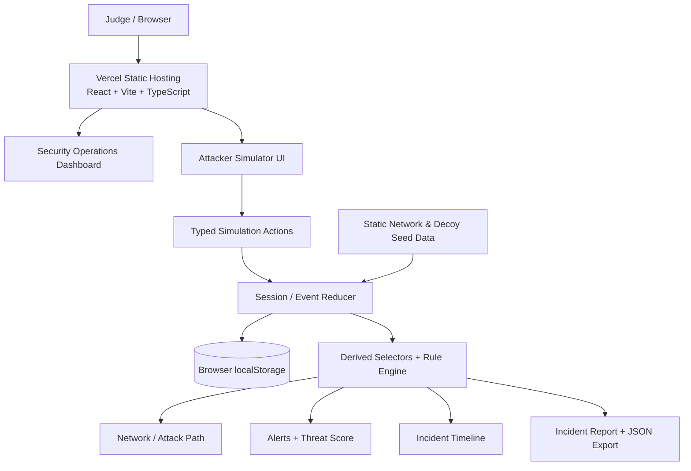
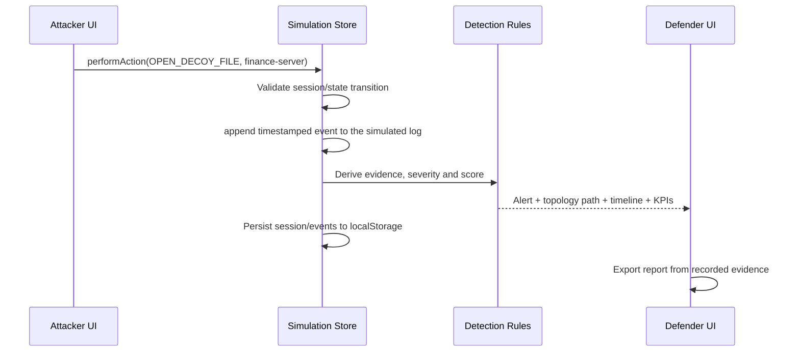

# PHANTOMNET — Prototype Architecture

## 1. Objective
Build a realistic **simulated** cyber-deception system for ORCA CODER Track 03: decoy digital assets (files, synthetic credentials, and monitored endpoints) trigger alerts when a simulated intruder touches them; the system reconstructs the intruder's path and generates an incident timeline. **No real network traffic or intruder telemetry is collected.**

## 2. Deployment architecture (one Vercel project)



**Hosting:** Vercel serves the static output under one public HTTPS URL. All simulation logic executes in the visitor's browser. **Persistence:** localStorage only, so sessions are not shared between judges or devices. No API/database/separate backend is required for the hackathon MVP.

## 3. UI layout

- **Overview:** total decoys, triggered alerts, event counts, session score, active incident and demo CTA.
- **Network:** interactive six-node React Flow graph, node inspection, attacker path overlays, defender-only decoy indicators.
- **Attack Simulator:** separate attacker-view panel, fake files and credentials; guarded actions such as scan, browse, open file, view credential, attempt login and lateral move.
- **Incidents:** alerts with evidence, chronological timeline, severity badges, incident report, export/reset.

## 4. Event-driven data flow



Every UI view reads from the **same session and event store**. In particular, a demo button should execute the same event actions as manual attacker clicks, not toggle separate pre-rendered fake alerts.

## 5. Domain model (TypeScript sketch)

```ts
type NodeId = 'gateway' | 'web' | 'workstation' | 'finance' | 'database' | 'decoy-vault';
type EventType =
  | 'SESSION_STARTED' | 'SCAN_HOST' | 'BROWSE_DIRECTORY'
  | 'LOGIN_FAILED' | 'SENSITIVE_FILE_OPENED' | 'HONEYTOKEN_VIEWED'
  | 'FAKE_CREDENTIAL_USED' | 'LATERAL_MOVE_ATTEMPT';
type Severity = 'info' | 'low' | 'medium' | 'high' | 'critical';

interface DecoyAsset {
  id: string;
  nodeId: NodeId;
  kind: 'file' | 'credential' | 'endpoint';
  label: string;
  honeytokenId: string;
  preview: string; // synthetic content only
}
interface IntrusionEvent {
  id: string;
  sessionId: string;
  timestamp: string; // ISO 8601
  type: EventType;
  actor: 'simulated-attacker';
  sourceNodeId?: NodeId;
  targetNodeId?: NodeId;
  assetId?: string;
  severity: Severity;
  explanation: string;
}
interface Session {
  id: string;
  startedAt: string;
  events: IntrusionEvent[];
  currentNodeId: NodeId;
}
```

**State transitions:** validate adjacent node movement and asset/node membership. The simulation must never execute commands on physical devices or arbitrary IP addresses.

## 6. Seed network

| Node | Documentation-only IP | Type | Example decoy |
|---|---|---|---|
| Gateway | `192.0.2.10` | monitored entry | synthetic login endpoint |
| Web Server | `192.0.2.20` | application | `/admin` simulation |
| Workstation | `192.0.2.30` | employee | finance document link |
| Finance Server | `192.0.2.40` | sensitive data | `payroll_Q3_2026.xlsx` |
| Database | `192.0.2.50` | data | `customer_backup.sql` |
| Decoy Vault | `192.0.2.60` | decoy | fake credentials |

Use reserved documentation IP addresses, not actual private-network targets. Render explicit connections in the network seed. Ensure the scripted movement sequence uses valid graph edges.

## 7. Detection and scoring

| Event | Severity | Score delta | Alert |
|---|---|---:|---|
| Scan host | info | +5 | no |
| Failed simulated login | low | +10 | optional |
| Open decoy sensitive file | high | +35 | yes |
| View fake honeytoken | high | +40 | yes |
| Use fake credentials | critical | +50 | yes |
| Attempt simulated lateral move | high | +25 | yes |

`threatScore = Math.min(100, sum(event deltas for active session))`. Always compute from stored events and avoid re-triggering on component render. Distinguish normal browsing from confirmed decoy interaction. An event's source and target nodes underpin the attacker-path rendering.

## 8. File structure

```text
phantomnet/
├── src/
│   ├── app/                 # root app and page composition
│   ├── components/
│   │   ├── layout/          # sidebar, header, KPI cards
│   │   ├── network/         # React Flow map, nodes, edges
│   │   ├── simulation/      # attacker console + action controls
│   │   ├── incidents/       # alerts, timeline, report
│   │   └── ui/              # reusable primitives
│   ├── data/                # graph, seeded synthetic decoys
│   ├── domain/
│   │   ├── types.ts
│   │   ├── simulation.ts     # validated events/reducer
│   │   ├── rules.ts          # rule-based detection
│   │   └── selectors.ts      # derivations for all views
│   ├── hooks/               # localStorage-backed store
│   ├── lib/                 # export, formatting, IDs
│   └── styles/
├── tests/                   # engine/scoring/report tests
├── ARCHITECTURE.md
├── ROADMAP.md
├── PHASE_STATUS.md
└── README.md
```

## 9. Security, privacy and honest scope

- All hosts, endpoint paths, fake credentials, decoy files and attacks are inert simulations.
- Browser localStorage is not an audit-grade log. It is editable and per browser; don't represent it as tamper-proof forensic evidence.
- Do not expose secrets, capture real passwords, run actual scans, connect to user networks, or execute shell commands from the web app.
- The simulation demonstrates the **logic** of cyber deception, not a deployed defensive sensor.
- “Adaptive decoy deployment” is an optional deterministic rule, not a trained AI model.

## 10. Deployment and validation

1. `npm install`
2. `npm run dev` — verify full attacker-to-alert flow locally.
3. `npm run build` — confirm `dist/` output.
4. Push repo to GitHub and import into Vercel, or run `npx vercel --prod` if authenticated; select Vite, build `npm run build`, output `dist`.
5. Only add an SPA rewrite if non-root client-side URLs are used.
6. Open the real deployment URL in an incognito browser. Verify all actions, path reconstruction, report export, refresh, reset and mobile layout.
7. Note that Vercel hosting alone doesn't provide cross-device event syncing; this MVP intentionally avoids it.
